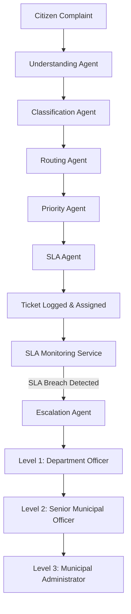

# CivicFlow AI — Multi-Agent Municipal Complaint Router & SLA Escalation Platform

> **Tagline**: *"AI-Powered Municipal Complaint Intelligence & Autonomous SLA Escalation Platform"*

CivicFlow AI is a production-ready, multi-agent municipal complaint management platform. It automates citizen grievance processing, classifies issue categories using hybrid NLP & rule semantics, routes complaints to responsible municipal departments, assigns dynamic SLA resolution deadlines, monitors live progress, and automatically escalates overdue cases across officer tiers.

---

## 📋 Problem Statement

Traditional municipal complaint resolution systems suffer from manual routing delays, lack of transparency, unmonitored resolution deadlines, and citizen frustration due to unhandled grievances. CivicFlow AI solves this by introducing:
- **Instant Autonomous Routing**: Eliminates manual triaging via a 5-stage AI agent pipeline.
- **Dynamic SLA Deadlines**: Automatically calculates resolution deadlines based on public safety severity.
- **Automated Escalation Matrix**: Tiered escalation alerts for municipal officers when SLAs are at risk or breached.
- **Citizen-Centric Transparency**: Real-time status tracking, visual progress timeline, and clear multi-agent execution telemetry.

---

## ✨ Key Features

- **Minimal Light Civic SaaS Interface**: Built with an off-white/emerald design system (`#F7F8F6`, `#FFFFFF`, `#16745A`).
- **5-Stage Multi-Agent AI Pipeline**: Understanding, Classification, Routing, Priority, and SLA Agents.
- **Interactive Citizen Dashboard (`/`)**: Guided category selection, character counter, GPS location capture, quick presets, and live processing animation.
- **Complaint Status Tracker (`/track`)**: Monospace ticket lookup, SLA countdown timer (Healthy, At Risk, Breached), 5-step progress timeline, and AI telemetry.
- **Personal Grievance Portal (`/my-complaints`)**: Overview metrics (Total, Open, In Progress, Resolved, Escalated) and direct tracking.
- **Role-Based Authentication**: Citizen and Staff/Admin JWT authentication with protected routes.
- **Municipal Command Dashboard (`/admin`)**: Real-time metrics overview, department workload charts (Recharts), status filters, officer action drawers, and live demo SLA breach simulation controls.
- **Resilient Dual Storage Architecture**: Operates with MongoDB or seamless automatic In-Memory engine fallback for zero-dependency local running.

---

## 🏗️ System Architecture



---

## 🧰 Tech Stack

### Frontend
- **Framework**: React 18 + Vite
- **Routing**: React Router DOM v6
- **Styling**: Modern CSS System (Vanilla CSS with CSS Custom Properties)
- **Icons**: Lucide React
- **Data Visualization**: Recharts
- **HTTP Client**: Axios

### Backend
- **Runtime**: Node.js + Express
- **Database**: MongoDB (via Mongoose) with automatic In-Memory store fallback
- **Authentication**: JWT (JSON Web Tokens) & Bcrypt password hashing
- **Automation**: Node.js interval SLA Audit Engine

---

## 🤖 Multi-Agent Workflow Breakdown

1. **Understanding Agent**: Analyzes complaint description, sanitizes input text, extracts key entities and sentiment indicators.
2. **Classification Agent**: Hybrid NLP & semantic rule engine determining category (*Sanitation*, *Water Supply*, *Roads & Traffic*, *Electricity*, *Public Health*, *General*).
3. **Routing Agent**: Maps classified issue directly to the corresponding municipal department.
4. **Priority Agent**: Evaluates public safety impact and assigns severity (*CRITICAL*, *HIGH*, *MEDIUM*, *LOW*).
5. **SLA Agent**: Calculates resolution target hours (*CRITICAL: 6h*, *HIGH: 24h*, *MEDIUM: 48h*, *LOW: 72h*) and assigns due dates.
6. **Escalation Agent**: Triggered upon SLA breach or manual staff escalation to elevate officer hierarchy tiers (Level 1 to Level 3).

---

## 📁 Project Structure

```
CivicFlow-AI/
├── backend/
│   ├── agents/            # Multi-agent NLP, routing, priority & SLA logic
│   ├── middleware/        # JWT auth & role validation middleware
│   ├── models/            # Mongoose schemas (User, Complaint)
│   ├── routes/            # Express API routes (auth, complaints, admin, sla)
│   ├── services/          # SLA audit monitor & dual ticket storage engine
│   ├── .env.example       # Backend environment template
│   ├── package.json
│   └── server.js          # Express server entry point
├── frontend/
│   ├── src/
│   │   ├── components/    # Navbar, StatsCard, ComplaintTimeline, AgentPipelineVisualizer
│   │   ├── context/       # AuthContext for JWT authentication state
│   │   ├── pages/         # CitizenHome, TrackComplaint, MyComplaints, Login, Register, AdminDashboard
│   │   ├── services/      # Axios API service module
│   │   ├── styles/        # Global CSS design tokens & component styles
│   │   ├── App.jsx        # Route definitions & layout wrappers
│   │   └── main.jsx       # Application mount point
│   ├── .env.example       # Frontend environment template
│   ├── package.json
│   └── vite.config.js
└── README.md
```

---

## ⚙️ Environment Variables

### Backend (`backend/.env.example`)
```env
PORT=5000
MONGO_URI=mongodb://127.0.0.1:27017/civicflow_db
JWT_SECRET=your_jwt_secret_key_here_change_in_production
```

### Frontend (`frontend/.env.example`)
```env
VITE_API_URL=http://localhost:5000/api
```

---

## 🚀 Local Setup & Installation

### Prerequisites
- **Node.js**: v18.0.0 or higher
- **npm**: v9.0.0 or higher
- **MongoDB**: Optional (If MongoDB is not running locally, the backend automatically switches to In-Memory Engine Fallback Mode).

### 1. Setup & Run Backend
```bash
cd backend
npm install
npm start
```
*Backend server runs on `http://localhost:5000`*

### 2. Setup & Run Frontend
```bash
cd frontend
npm install
npm run dev
```
*Frontend application runs on `http://localhost:5173`*

---

## 🧪 Demo Workflow for Presentations

1. Open `http://localhost:5173` in your browser.
2. Click any **Quick Sample Issue** button (e.g. *"Garbage has not been collected from our street for 3 days"*).
3. Click **Capture Current Location** and click **Submit Complaint** to watch the real-time AI Agent execution animation.
4. Copy the returned Ticket ID (e.g. `CIV-1001`) and inspect the multi-agent telemetry output.
5. Log in as staff/admin (`admin@civicflow.gov` / `admin123` or register a new staff user).
6. View the **Municipal Operations Dashboard** (`/admin`) to inspect workload charts, department distribution, and ticket management tables.
7. Open any ticket modal and click **Simulate SLA Breach** to trigger immediate multi-agent level escalation!
8. Open **Track Complaint** (`/track`) to verify that the citizen status timeline reflects the escalated officer state.

---

## ⚡ Linting & Production Build Validation

### Linting
```bash
cd frontend
npm run lint
```
*Status: Passed (0 errors)*

### Production Build
```bash
cd frontend
npm run build
```
*Status: Passed cleanly in ~750ms*

---

## 📄 License & Disclaimer

This software is developed as a civic-tech prototype demonstrating multi-agent AI orchestration for municipal complaint management.
